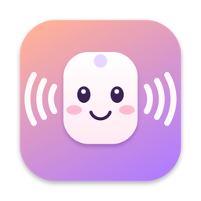
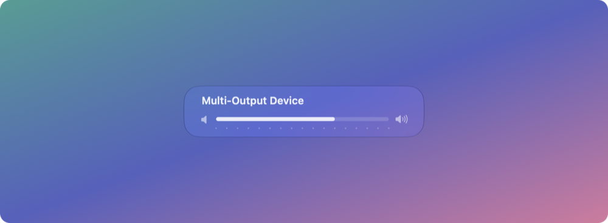
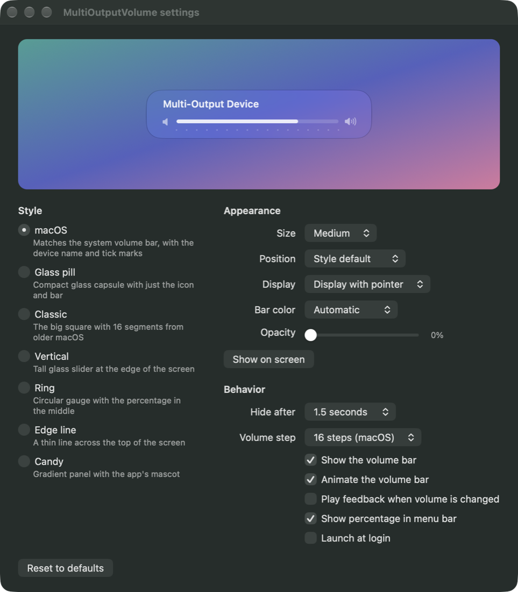

<p align="center">
  
</p>

<h1 align="center">MultiOutputVolume</h1>

<p align="center">
  <b>Make your keyboard's volume keys work with a macOS Multi-Output Device.</b><br>
  Play audio through two displays (or any set of speakers) at once, and keep volume up, down and mute.
</p>

<p align="center">
  <a href="https://github.com/jackfan108/MultiOutputVolume/releases/latest"></a>
  
  
  
  <a href="LICENSE"></a>
</p>

<p align="center">
  
</p>

## Why

A **Multi-Output Device** (made in Audio MIDI Setup) is the built-in way to play sound through several outputs at once, for example two Apple Studio Displays. The catch: macOS disables volume control for it. The volume keys show a crossed-out speaker and the slider in Control Center is grayed out.

MultiOutputVolume is a tiny menu bar app that brings the keys back. When a Multi-Output Device is your output, volume up, down and mute change the volume of every speaker in it together, with an on-screen volume bar that looks like the system one.

## Features

- **Volume keys just work.** Up, down and mute control every speaker in the Multi-Output Device at the same time. Other outputs are left to macOS.
- **Native-looking volume bar** with Liquid Glass on macOS 26, plus 6 more styles to pick from.
- **Smooth when you hold a key.** Volume changes are batched in the background, so holding a key never stutters.
- **Fine steps:** hold <kbd>⌥ Option</kbd> + <kbd>⇧ Shift</kbd> while pressing a volume key for quarter steps, just like macOS.
- **Customizable:** size, position, which display, bar color (including your own gradient), background opacity, hide delay, step size, feedback sound, and a percentage in the menu bar.
- **Live preview** in Settings, so you see every change before you press a key.
- **Lightweight:** about 17 MB of memory and 0% CPU while idle. No network access, no telemetry, no dependencies.

## Screenshots

<p align="center">
  
</p>

### Seven styles

| | |
|:---:|:---:|
| <br>**macOS**: the system volume bar, with device name and tick marks | <br>**Glass pill**: a compact glass capsule |
| <br>**Classic**: the big square with 16 segments from older macOS | <br>**Vertical**: a tall glass slider at the edge of the screen |
| <br>**Ring**: a circular gauge with the percentage | <br>**Edge line**: a thin line across the top of the screen |
| <br>**Candy**: a gradient panel with the app's mascot | <br>**Menu bar**: the icon, with the current volume |

## Install

1. Download **[MultiOutputVolume.zip](https://github.com/jackfan108/MultiOutputVolume/releases/latest/download/MultiOutputVolume.zip)** from the latest release.
2. Unzip it and drag **MultiOutputVolume.app** into **Applications**.
3. Open it. The app isn't notarized by Apple, so the first launch is blocked. Allow it in one of these ways:
   - Open **System Settings → Privacy & Security**, scroll down and click **Open Anyway** next to MultiOutputVolume.
   - Or run this in Terminal:
     ```sh
     xattr -dr com.apple.quarantine /Applications/MultiOutputVolume.app
     ```
4. Grant **Accessibility** access when asked (**System Settings → Privacy & Security → Accessibility**, turn on MultiOutputVolume). The app needs it to receive the volume keys before macOS does.

A speaker icon appears in the menu bar. Click it for Settings, or open the app again from Applications.

To start it automatically, turn on **Launch at login** in Settings.

## Set up a Multi-Output Device

If you don't have one yet:

1. Open **Audio MIDI Setup** (in Applications → Utilities).
2. Click **+** in the bottom left and choose **Create Multi-Output Device**.
3. Check every output you want to play through, for example both displays.
4. Pick a **Primary Device** and turn on **Drift Correction** for every device except the primary one.
5. Select the Multi-Output Device as your output in **System Settings → Sound** or Control Center.

The volume keys now work through MultiOutputVolume.

## Usage

| Key | Action |
|---|---|
| <kbd>🔊</kbd> / <kbd>🔉</kbd> | Volume up / down by one step |
| <kbd>🔇</kbd> | Mute or unmute every speaker |
| <kbd>⌥</kbd> <kbd>⇧</kbd> + <kbd>🔊</kbd> / <kbd>🔉</kbd> | Change volume by a quarter step |

The menu bar menu shows the current output and volume, and opens Settings (<kbd>⌘</kbd> <kbd>,</kbd>). If the app ever loses Accessibility access, the menu shows a warning that takes you straight to the right settings page.

## Build from source

You need the Xcode Command Line Tools (`xcode-select --install`). No Xcode project or third-party packages are required.

```sh
git clone https://github.com/jackfan108/MultiOutputVolume.git
cd MultiOutputVolume
./build.sh          # builds build/MultiOutputVolume.app (universal: Apple Silicon + Intel)
./build.sh --zip    # also packages build/MultiOutputVolume.zip
open build/MultiOutputVolume.app
```

Every build is signed ad hoc, which changes the app's signature. The build script therefore resets the app's Accessibility entry, so grant access again after each rebuild.

## How it works

- **Keys:** a `CGEventTap` listens for the system media-key events (volume up, down and mute). When the output is a Multi-Output Device, the app handles the key and stops macOS from showing its "not available" indicator. Otherwise the key passes through untouched.
- **Volume:** Core Audio lists the device's active sub-devices and sets the volume and mute of each one: the main volume control if a device has one, otherwise each stereo channel.
- **Speed:** the device list is cached for the length of a key press, and writes go to a background queue that only keeps the latest value, so a held key never builds up a backlog.
- **UI:** the volume bar is drawn with Core Animation layers on `NSGlassEffectView` (Liquid Glass) on macOS 26, falling back to a blur on earlier versions. The app is AppKit only, with no SwiftUI or Electron.

## Troubleshooting

**The volume keys don't do anything.**
Open **System Settings → Privacy & Security → Accessibility**. If MultiOutputVolume is listed but on, remove it with **–**, then reopen the app and grant access again. This is needed after updating or rebuilding the app.

**The keys still show the macOS "not available" indicator.**
Make sure the Multi-Output Device is the selected output and the app is running (its icon is in the menu bar).

**One speaker doesn't change volume.**
Some devices don't expose a volume control to Core Audio. Those stay at their own volume, and every other speaker still changes.

**Logs** are written to `~/Library/Logs/MultiOutputVolume.log`.

## Uninstall

Quit the app from its menu, delete it from Applications, then optionally clear its settings and permission:

```sh
defaults delete com.jackfan.MultiOutputVolume
tccutil reset Accessibility com.jackfan.MultiOutputVolume
```

## Privacy

MultiOutputVolume never connects to the network and collects nothing. Accessibility access is used only to receive the volume keys. Settings stay on your Mac in its preferences file.

## License

[MIT](LICENSE) © 2026 Jack Fan
